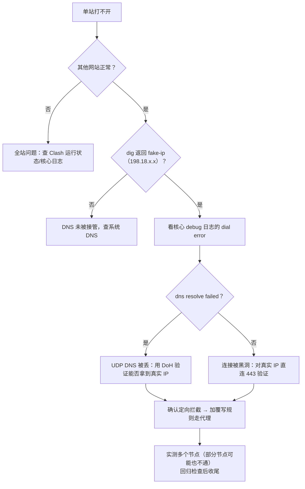

# 语雀定向拦截排查与 Clash 覆写规则修复

> 浏览器打不开语雀（其他网站全部正常），最终定位为**本机所在网络对语雀的定向拦截**：域名的 UDP DNS 查询被丢弃、直连 IP 被黑洞，而 Clash 规则把语雀判为国内域名直连，直连必死。最终在 Clash 客户端的档案覆写（override）里追加两条规则，**让语雀走代理出去**解决。
>
> 本文由 2026-10-26 一次实际排障整理而成，含完整排查链路、走过的弯路与复发速查表，可作为同类"单站不通"问题的排查模板。
>
> **隐私说明：机场订阅名称已脱敏，节点名保留（复发排查需要对照）。**

## 目录

- [1. 环境背景](#1-环境背景)
- [2. 排查过程](#2-排查过程)
- [3. 修复过程（含走过的弯路）](#3-修复过程含走过的弯路)
- [4. 最终状态（已验证）](#4-最终状态已验证)
- [5. 复发速查表](#5-复发速查表)
- [6. 附录：关键路径与命令](#6-附录关键路径与命令)

---

## 1. 环境背景

排查前需要知道的事实：

| 项目 | 情况 |
|---|---|
| 代理客户端 | `/Applications/Clash.app`（bundle id: `com.hako.network`，mihomo 1.19.32 内核） |
| 工作模式 | TUN（增强模式）+ fake-ip DNS，接管全部流量和 DNS |
| 关键依赖 | **断开 Clash 整机断网**（物理网络的 DNS 查询不通，系统 DNS 全靠 Clash 的 TUN 接管） |
| 机场 | 某机场订阅（名称略），85 个节点，策略组 `PROXY → AUTO`（url-test 自动选节点） |
| Clash 规则 | 仅 6 条内置基础规则：国内域名/IP 直连（`GEOSITE,cn,DIRECT`），其余走代理（`MATCH,PROXY`） |

## 2. 排查过程

### 2.1 确认"只有语雀不通"

```
curl https://www.baidu.com/    → 200 (0.12s)  ✓
curl https://www.google.com/   → 200 (1.1s)   ✓
curl https://www.yuque.com/    → 000 连接失败 ✗
```

同时发现 `dig www.yuque.com` 返回 **198.18.0.42** —— 这是 Clash fake-ip 的假地址，说明 DNS 被 Clash 接管（这是正常现象，不是故障）。

### 2.2 排除"语雀全站宕机"

网络搜索没有任何语雀当前故障的消息（只有 2023-10-23 那次历史宕机）。

### 2.3 尝试"退出 Clash 直连"——失败，但很有信息量

退出 Clash 后**整机断网**（DNS 服务器直接失联），重启 Clash 网络才恢复。

→ 结论：这台机器的网络**离开代理就无法上网**，"关梯子直连"这条路走不通，也解释了为什么必须修代理配置而不是绕开代理。

### 2.4 开启核心 debug 日志，抓到决定性证据

通过 Clash 的 API（Unix socket）开日志流，同时发起语雀请求：

```json
{"payload":"[DNS] resolve www.yuque.com A from udp://114.114.114.114:53 ..."}
{"payload":"[DNS] resolve www.yuque.com A from udp://223.5.5.5:53 ..."}   （反复重试）
{"payload":"[TCP] dial DIRECT (match GeoSite/cn) --> www.yuque.com:443
    error: dns resolve failed: couldn't find ip: context deadline exceeded"}
```

两个关键信息：

- **路由是对的**：语雀命中"国内域名直连"规则（GeoSite/cn → DIRECT），Clash 没配错；
- **死在 DNS**：核心向 114.114.114.114 和 223.5.5.5 发的 UDP DNS 查询全部超时，拿不到真实 IP，直连拨号失败。

### 2.5 对照实验：是"DNS 全坏"还是"只针对语雀"？

同时测试几个"冷门"国内网站（太平洋电脑网、汽车之家）——**全部秒开**。同一时刻、同样的 UDP 53 查询，别的域名都成功，唯独 `yuque.com` 被丢包。

再用 DoH（加密 DNS，`https://223.5.5.5/resolve`）绕过 UDP 拿到语雀真实 IP `203.107.62.20`，然后直接向这个 IP 的 443 端口发起连接——**也超时**。

### 2.6 根因认定

> 本网络对语雀做了**定向拦截**：域名的 UDP DNS 查询被丢弃（DoH 加密查询不受影响，能拿到正确 IP），且对语雀服务器的直连 TCP 也被黑洞。常见于公司/校园网对云文档类站点的封锁，或运营商侧问题。

### 2.7 验证"走代理能不能通"

临时切全局模式，实测三条机场线路：

| 节点 | 访问语雀 |
|---|---|
| 【chatgpt】美国原生-01（AUTO 当前选中） | **200 ✓** |
| v5【a】香港 icable | **200 ✓** |
| v5【a】新加坡 | 000 ✗ |

→ 走代理可行，且**不是所有节点都行**（新加坡不通，这是日后复发时的重要排查线索）。

## 3. 修复过程（含走过的弯路）

### ❌ 弯路 1：改配置文件 + API 热重载

找到核心实际加载的 `working/active/config.yaml`，在 `rules:` 最前面插入两条规则，然后调 API 热重载：`PUT /configs?force=true` → **405**，此客户端不支持热重载。

### ❌ 弯路 2：文件级注入 + 重启

把规则注入到能找到的所有文件（active 配置、3 份 resolved 配置、内置规则源 `hako-basic-rules`），重启客户端。结果：**应用启动时从内部管线重新生成配置，注入全部被抹掉**。甚至尝试破解其版本号算法（= 文件内容 SHA256 前 12 位）并保持一致，应用依然不认——内置规则源会被应用从程序内置兜底重建。文件级注入此路不通。

（中途有一次因多文件状态不一致导致核心启动失败、网络半瘫，靠还原备份恢复——**改这类文件必须先备份**。）

### ✅ 正确方案：档案的 override.appendRules（应用自带覆写机制）

在 `working/store/profiles.json` 中，订阅档案有一个 `override` 字段（这是应用 UI 里"覆写/自定义规则"的存储位置）：

```json
"override": {
  "prependRules": true,
  "appendRules": [],
  "patchJSON": ""
}
```

往 `appendRules` 里写入两条规则，然后**重启 Clash 客户端**：

```json
"appendRules": [
  "DOMAIN-SUFFIX,yuque.com,PROXY",
  "DOMAIN-SUFFIX,nlark.com,PROXY"
]
```

应用启动时读取 profiles.json → 识别覆写变更 → 重新物化配置 → 新规则被插入到规则表**最顶部**。

## 4. 最终状态（已验证）

**规则表（8 条，前两条即新增）：**

```
1. DomainSuffix:yuque.com -> PROXY      ← 新增
2. DomainSuffix:nlark.com  -> PROXY     ← 新增（语雀图片/静态资源域名）
3. GeoIP:private           -> DIRECT
4. GeoSite:private         -> DIRECT
5. GeoSite:geolocation-!cn -> PROXY
6. GeoSite:cn              -> DIRECT
7. GeoIP:cn                -> DIRECT
8. Match                   -> PROXY
```

**实测连接链路：**

```
www.yuque.com → PROXY → AUTO → 【chatgpt】美国原生-01   命中规则: DomainSuffix:yuque.com
www.nlark.com → PROXY → AUTO → 【chatgpt】美国原生-01   命中规则: DomainSuffix:nlark.com
```

**回归检查**：yuque 200 ✓｜baidu 200 ✓｜google 200 ✓｜bilibili 200 ✓

## 5. 复发速查表

| 症状 | 原因 | 处理 |
|---|---|---|
| 只有语雀打不开，其他正常 | AUTO 自动切换到了**新加坡**等连不上语雀的节点 | 在客户端把 PROXY 组切到香港/美国家宽节点 |
| 所有网站都打不开 | Clash 未运行 / 核心启动失败 | 重启 Clash 客户端；本机断开 Clash 会整机断网 |
| 语雀规则消失 | 在客户端里删除重建了订阅档案，或清空了覆写设置 | 在档案的覆写（appendRules）里重新加回那两条规则 |

## 6. 附录：关键路径与命令

```bash
# Clash API（Unix socket；GET 可用，PUT 热重载不支持）
SOCK="$HOME/Library/Group Containers/group.com.hako.network/clash.sock"
curl -s --unix-socket "$SOCK" http://localhost/rules     # 查看生效规则
curl -s --unix-socket "$SOCK" http://localhost/proxies   # 查看节点/策略组
curl -sN --unix-socket "$SOCK" 'http://localhost/logs?level=debug'  # debug 日志流

# 持久规则所在文件（override.appendRules）
"$HOME/Library/Group Containers/group.com.hako.network/working/store/profiles.json"

# 本次所有被修改过的文件都留有备份（同目录 *.bak-20261026）
```

**诊断心法**：先二分"全站问题还是单站问题"→ 再二分"解析问题还是连接问题"（看核心日志的 dial error）→ 最后用受控实验验证修复假设（一次只改一个变量，改前必备份）。


